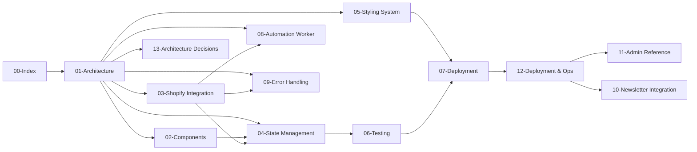

# Documentation Index

Welcome to the House of Mornii Shop application documentation. This documentation set provides comprehensive coverage of the architecture, components, integrations, and operational procedures for this React e-commerce storefront.

## Quick Links

| Document | Description |
|----------|-------------|
| [01 - Architecture](./01-architecture.md) | Application architecture, tech stack, data flow, directory structure |
| [02 - Components](./02-components.md) | Complete component library with props, purposes, and relationships |
| [03 - Shopify Integration](./03-shopify-integration.md) | Storefront API integration, token-only mode, queries, mutations |
| [04 - State Management](./04-state-management.md) | CartContext, TanStack Query, localStorage patterns |
| [05 - Styling System](./05-styling-system.md) | Tailwind CSS 4, design tokens, OKLCH colors, animations |
| [06 - Testing](./06-testing.md) | Vitest setup, Playwright E2E, testing patterns |
| [07 - Deployment](./07-deployment.md) | Environment variables, Cloudflare Pages, CI/CD |
| [08 - Shopify Automation Worker](./08-shopify-automation-worker.md) | Cloudflare Worker: webhooks, scheduled backups |
| [09 - Error Handling](./09-error-handling.md) | StorefrontError, error categories, page-level error patterns |
| [10 - Newsletter Integration](./10-newsletter-integration.md) | Provider-neutral newsletter architecture and provider research |
| [11 - Shopify Admin Reference](./11-shopify-admin-reference.md) | Admin management guide and dev store setup checklist |
| [12 - Deployment & Operations](./12-deployment-operations.md) | Deployment runbook, DNS/SSL, launch checklist, API version updates |
| [13 - Architecture Decisions](./13-architecture-decisions.md) | Key decisions, remediation history, lessons learned |
| [14 - Test Coverage Analysis](./14-test-coverage-analysis.md) | Comprehensive test coverage assessment, gaps, and recommendations |
| [15 - Production Readiness Audit](./15-production-readiness-audit.md) | Blockers/warnings audit before production launch |
| [16 - End-to-End Tests](./16-end-to-end-tests.md) | Playwright journeys, tiers, local and CI runs, test data, session refresh |
| [17 - Enquiries](./17-enquiries.md) | Enquiry form and Worker: checks, email, Email Routing and Turnstile setup, secrets, testing delivery |

## Documentation Structure

## Reading Order Recommendations

### For New Contributors

1. **[01 - Architecture](./01-architecture.md)** - Understand the tech stack and project structure
2. **[02 - Components](./02-components.md)** - Learn the component library
3. **[07 - Deployment](./07-deployment.md)** - Set up local development environment

### For Shopify Integration Work

1. **[03 - Shopify Integration](./03-shopify-integration.md)** - API modes, queries, mutations
2. **[08 - Shopify Automation Worker](./08-shopify-automation-worker.md)** - Webhooks, backups
3. **[09 - Error Handling](./09-error-handling.md)** - Error categories and page patterns
4. **[04 - State Management](./04-state-management.md)** - Cart persistence patterns

### For UI/Design Work

1. **[05 - Styling System](./05-styling-system.md)** - Tailwind, OKLCH colors, animations
2. **[02 - Components](./02-components.md)** - Component API reference
3. **[GOLDEN_GLOW_GUIDE.md](../GOLDEN_GLOW_GUIDE.md)** - Golden glow system details

### For DevOps/Deployment

1. **[07 - Deployment](./07-deployment.md)** - Environment setup, Cloudflare Pages
2. **[12 - Deployment & Operations](./12-deployment-operations.md)** - Runbook, DNS/SSL, launch checklist
3. **[08 - Shopify Automation Worker](./08-shopify-automation-worker.md)** - Worker deployment and secrets
4. **[06 - Testing](./06-testing.md)** - CI pipeline, test configuration
5. **[.env.example](../.env.example)** - Complete environment variable reference

### For Business/Stakeholders

1. **[11 - Shopify Admin Reference](./11-shopify-admin-reference.md)** - Day-to-day store management
2. **[10 - Newsletter Integration](./10-newsletter-integration.md)** - Newsletter provider options
3. **[13 - Architecture Decisions](./13-architecture-decisions.md)** - Key decisions and lessons learned

## AI Agent Tools (`.roo/`)

| Path | Purpose |
|------|---------|
| [`.roo/skills/checkpoint/SKILL.md`](../.roo/skills/checkpoint/SKILL.md) | Automated checkpointing: git commit + doc update + RAG memory vector sync |
| [`.roo/skills/rag-memory-search/SKILL.md`](../.roo/skills/rag-memory-search/SKILL.md) | Qdrant semantic search with nomic-embed-text embeddings |
| [`.roo/rules-ui-design/` (7 files)](../.roo/rules-ui-design/) | UI Designer mode rules: workflow, best practices, common patterns, decision guidance, examples, error handling, communication |
| [`.roo/rules-*/AGENTS.md`](../.roo/rules-architect/AGENTS.md) | Mode-specific agent rules (architect, ask, code, debug) |
| [`.roomodes`](../.roomodes) | Custom mode definitions and configurations |

## Related Documents (Outside This Folder)

| File | Purpose |
|------|---------|
| [`../README.md`](../README.md) | Project overview and quick start |
| [`../PRD.md`](../PRD.md) | Product requirements and design direction |
| [`../GOLDEN_GLOW_GUIDE.md`](../GOLDEN_GLOW_GUIDE.md) | Golden glow under-lighting system guide |
| [`../.env.example`](../.env.example) | Environment variable templates |
| [`../AGENTS.md`](../AGENTS.md) | Repository rules and conventions |

## Key Concepts Summary

### Storefront Mode

The application operates in **token-only mode**. All environments (local, UAT, production) require real Shopify credentials — `VITE_SHOPIFY_STORE_DOMAIN` and `VITE_SHOPIFY_STOREFRONT_TOKEN`. There is no demo or tokenless fallback; `client.ts` throws at module load if credentials are missing or placeholder values.

### State Management Layers

1. **Server state** - TanStack Query (products, collections)
2. **Client state** - React Context (cart, theme)
3. **Persistent state** - localStorage/sessionStorage (cart ID, theme preference)

### Styling Architecture

- Tailwind CSS 4 with `@tailwindcss/vite` plugin (no PostCSS)
- SCSS mixins for complex patterns (`ornamental-surface`)
- CSS custom properties for theming (dark/light mode)
- OKLCH color space for perceptually uniform colors
- Framer Motion for animations with `luxuryEase` easing

### Testing Strategy

- **Vitest** - Unit and integration tests (jsdom environment)
- **Playwright** - End-to-end browser tests (Chromium)
- **Manual** - Visual/design validation
